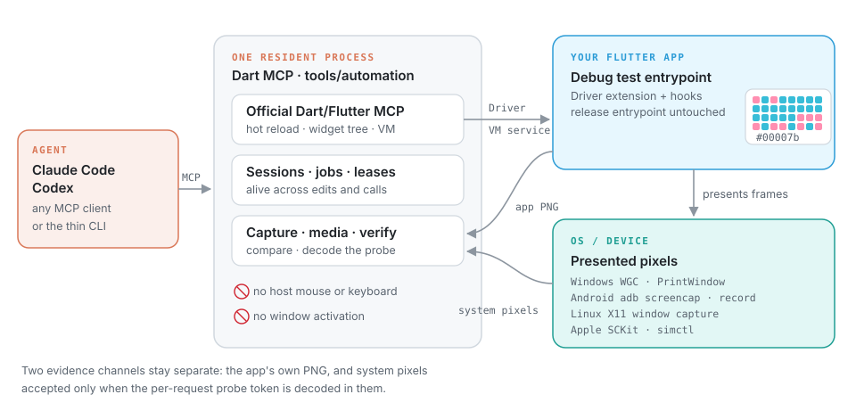

# Flutter UI Automation

English | [简体中文](README_zh.md)

[](https://github.com/normalllll/flutter-ui-automation/actions/workflows/ci.yml)
[](LICENSE)

Let an AI agent test and visually check a real Flutter app — tap, type, scroll,
hot reload, take screenshots and record — **without touching your mouse,
keyboard or window focus**. You keep working on the same desktop while it runs.

It ships as an agent skill (Claude Code, Codex) plus a resident Dart MCP server
that drives the app through Flutter Driver, on Windows, Android, Linux X11,
macOS and the iOS Simulator.

<p align="center">
  
</p>

## Why it is different

- **Background by design.** No synthetic OS input, no window activation. Input
  goes through Flutter's own pointer, text and key paths; captures are scoped to
  one window or device.
- **Two kinds of evidence.** Each capture keeps the app's own PNG and the pixels
  the OS actually presented. They are compared, never mixed.
- **Proof the frame is fresh.** Before a system capture the app shows a small
  8×4 dot-matrix probe carrying a per-request token. A capture is accepted only
  when that token is decoded in its pixels, so blank or stale frames are rejected.
- **One session that stays alive.** Edit source, hot reload or restart, and keep
  testing the same native process. Long operations run as cancellable jobs.
- **Honest media.** Recordings keep original frames and verified lossless masters
  where the platform allows; Android screenrecord is reported as lossy.

## Platforms

| Platform | App control | System capture | Notes |
| --- | --- | --- | --- |
| Windows | Flutter Driver | WGC / PrintWindow, scoped to one HWND | Interactive desktop |
| Android | Flutter Driver | ADB screenshot and screenrecord, explicit device | Real lifecycle and IME |
| Linux | Flutter Driver | X11 window capture | Wayland capture not implemented |
| macOS | Flutter Driver | ScreenCaptureKit window helper | Needs Screen Recording permission |
| iOS Simulator | Flutter Driver | `simctl`, explicit UDID | No physical-device backend |

Current evidence and limits are tracked in [validation status](docs/validation-status.md).

## Quick start

1. Install the prerequisites and the skill: [installation](docs/installation.md).
2. Build the service once and register it as your MCP server.
3. Start the reference fixture, drive it and capture both channels:
   [quick start](docs/quickstart.md).

To automate your own app, add a Debug test entrypoint and attach to it — see
[integrating an app](references/mcp.md#integrating-an-app).

## Documentation

| Topic | Read |
| --- | --- |
| Workflow, tools, sessions and CLI | [MCP workflow](references/mcp.md) |
| Windows · Android | [Windows](references/windows.md) · [Android](references/android.md) |
| Linux · macOS/iOS · remote hosts | [Linux](references/linux.md) · [Apple](references/apple.md) · [Remote](references/remote.md) |
| Presentation probe and capture fidelity | [Capture](references/capture.md) |
| Foreground simulation boundary | [Foreground](references/foreground.md) |
| Standalone Windows window capture | [Usage](references/usage.md) |
| Measurements and reproduction | [MCP validation](docs/mcp-validation.md) |
| Agent instructions | [SKILL.md](SKILL.md) |

## Repository layout

```text
tools/automation/      Resident Dart MCP, CLI and regression tests
tools/window_capture/  Windows WGC/PrintWindow capture helper (C++20)
tools/linux_capture/   X11 capture helper
tools/macos_capture/   ScreenCaptureKit capture helper
examples/capture_lab/  Flutter reference fixture for every platform
references/  docs/     Workflow, platform guides, validation
scripts/               Repository checks and standalone Windows capture
```

## Contributing and license

Development checks are in [CONTRIBUTING.md](CONTRIBUTING.md); changes are in
[CHANGELOG.md](CHANGELOG.md). Report security issues as described in
[SECURITY.md](SECURITY.md).

Copyright (C) 2026 [normalllll](https://github.com/normalllll). Licensed under
**GPL-3.0-or-later** — see [LICENSE](LICENSE), [COPYRIGHT](COPYRIGHT) and
[third-party notices](THIRD_PARTY_NOTICES.md).
